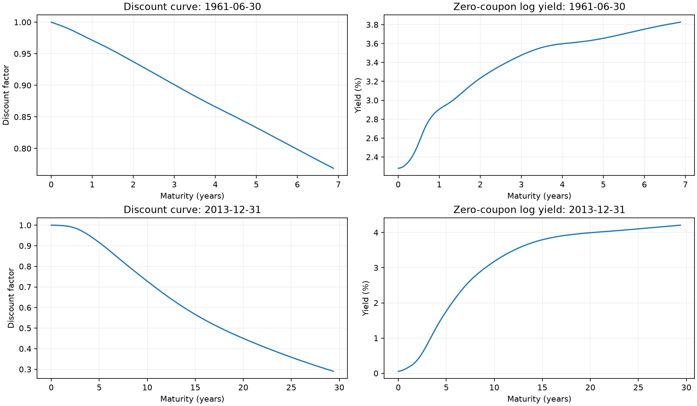
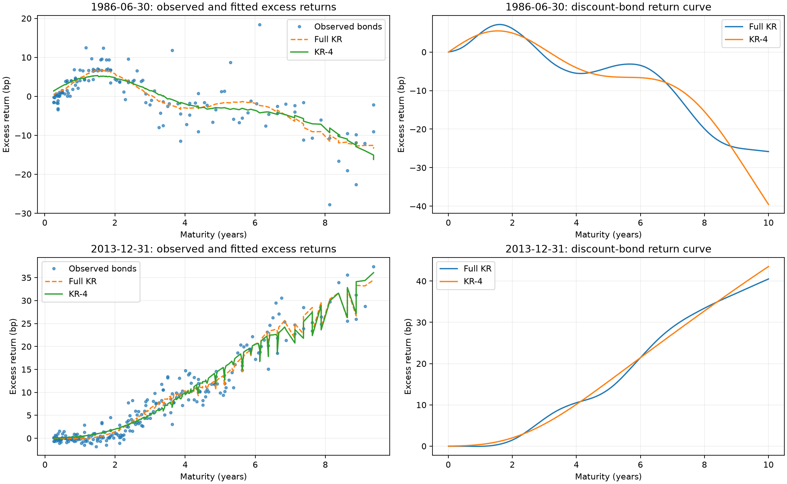
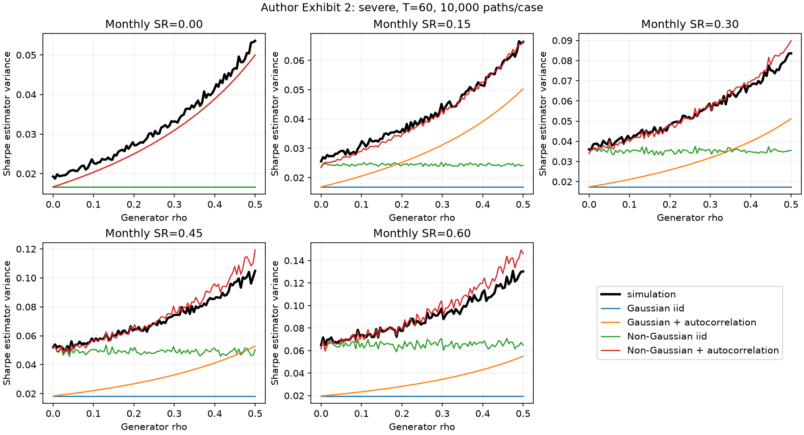

# 金融计量论文核心实验复现

三篇此前未在本项目中复现的论文，覆盖国债贴现曲线、期限结构因子与 Sharpe 比率统计推断。仓库提供我们编写的运行包装、独立数值核验、固定版本下载器和精选结果；作者代码及输入数据通过下载器在本地获取，不随仓库重新发布。

这里的完成范围是 **core experiments（核心实验）**。两篇国债论文使用作者附带的两个真实交易日期；Sharpe 论文运行固定版本作者代码的数值例子，以及 Exhibit 2 主模拟块的全部参数网格。它们不等同于三篇论文所有表格、所有 Notebook、所有图的完整复现。

## 论文与版本

| 项目 | 论文 | 版本时间 | 本次范围 |
| --- | --- | --- | --- |
| `stripping_discount_curve` | [Stripping the Discount Curve — a Robust Machine Learning Approach](https://pubsonline.informs.org/doi/10.1287/mnsc.2023.01401)，Filipović、Pelger、Ye | 首稿 2022-03-15；期刊首次在线 2025-12-22；Management Science 72(9)，2026 年 9 月 | 作者原始 KR 估计器，1961-06-30 的 50 只国债和 2013-12-31 的 280 只国债；贴现曲线、收益率与定价拟合；补充岭惩罚敏感性 |
| `shrinking_term_structure` | [Shrinking the Term Structure](https://academic.oup.com/rof/advance-article/doi/10.1093/rof/rfag033/8767770)，Filipović、Pelger、Ye | 首稿 2022-08-04；Review of Finance 接受稿在线 2026-08-21 | 作者原始完整 KR 和 KR-1 至 KR-10；1986-06-30 的 140 只国债、2013-12-31 的 239 只国债；独立留一债券交叉验证 |
| `sharpe_ratio_inference` | [How to Use the Sharpe Ratio](https://ssrn.com/abstract=5520741)，López de Prado、Lipton、Zoonekynd | SSRN 首次发布 2025-10-04；论文修订 2026-03-25；本次作者代码固定在 2026-02-05 | 作者数值例子、7 项推断检查、独立公式核对；Exhibit 2 主模拟块 2,000 个参数组合，每组合 10,000 条路径、60 期 |

国债代码来自 [Pelger 官方数据与代码页](https://mpelger.people.stanford.edu/data-and-code)，分别指向 [KR_example](https://github.com/yye9701/KR_example) 和 [KR_return_example](https://github.com/rosieiiiii/KR_return_example)。Sharpe 论文使用 [Zoonekynd 作者仓库](https://github.com/zoonek/2025-sharpe-ratio)；论文介绍另见 [ADIA Lab](https://www.adialab.ae/research-series/how-to-use-the-sharpe-ratio)。

固定代码提交：

- Stripping：`0e13390c2b5a663545170fad5072b7b423d3793a`
- Shrinking：`7cbfa4635c8461995ff9bcea74fff2818fe4618f`
- Sharpe：`6199ecb1c84da7eee7bd81d9a017cf12b8ff0e0d`

各项目的 `source_manifest.json` 记录下载地址、原始文件和 ZIP 的 SHA-256；`paper_metadata.json` 记录论文来源、日期、执行范围和限制。下载器在提取前验证 ZIP，随后逐文件核验，拒绝不匹配内容、额外文件、重复路径和符号链接。

## 本地运行

本地验证环境为 macOS ARM、Python 3.14.6。`requirements.txt` 锁定实际使用的包版本；Sharpe 的 `Deprecated` 和 `wrapt` 对应本次隔离依赖版本。建议使用独立虚拟环境：

```bash
python -m venv .venv
source .venv/bin/activate
python -m pip install -r requirements.txt
python setup_sources.py
python setup_sources.py --verify-only
```

下载器只获取固定版本公开文件，不安装包，不执行作者代码，不访问私人仓库或账户。首次下载需要网络；其后的计算可以离线执行。全历史国债研究需要 WRDS/CRSP 权限，本仓库的两个日期实验使用作者公开附带的样本。

依次执行三个实验：

```bash
export OPENBLAS_NUM_THREADS=2
export OMP_NUM_THREADS=2
export MPLBACKEND=Agg
python stripping_discount_curve/replication_runner.py
python shrinking_term_structure/replication_runner.py
python sharpe_ratio_inference/replication_runner.py
```

Stripping 完整生成作者 30 年每日期限网格的核矩阵，矩阵本身约 0.96 GB。Shrinking 完整计算 3650 × 3650 核矩阵的 SVD。Sharpe 完整网格耗时随硬件变化，终端每完成 100 个组合输出进度。只核验 Sharpe 数值例子可运行：

```bash
python sharpe_ratio_inference/replication_runner.py --mode numeric
```

这条快速命令没有完成 Exhibit 2。完整复现仍需默认模式或 `--mode all`。

仓库根目录中的 `three_finance_papers.ipynb` 提供 Jupyter 入口、过程日志与图表。Notebook 和终端调用同一组包装脚本，结果写入各项目的 `results/`。

## 标准核验

首先确认下载文件完整，再编译我们自己的脚本，执行实验，最后运行独立验证器：

```bash
python setup_sources.py --verify-only
python -m compileall -q setup_sources.py validate_replication.py run_notebook.py stripping_discount_curve/replication_runner.py shrinking_term_structure/replication_runner.py sharpe_ratio_inference/replication_runner.py
python run_notebook.py
python validate_replication.py --notebook three_finance_papers.ipynb
```

便携 Notebook 的批量执行器 `run_notebook.py` 使用当前 Python 环境启动新内核，执行全部单元格并保存输出；也可在 Jupyter 界面逐格运行。

验证结果记录在 `validation_report.json`。完整验证要求三个实验的结果齐备；仅下载作者文件或仅运行快速数值检查不能替代完整复现。

- Stripping：检查作者文件哈希，独立求根核对 YTM，核对解析核公式、显式矩阵逆与独立线性求解、正规方程残差及观测期限内贴现因子。
- Shrinking：检查源文件哈希与受限 NumPy pickle 读取；核对核公式、独立完整 KR 解及留一债券预测；核对保存的 1–10 因子结果。
- Sharpe：执行作者推断检查，核对 K=1 方差、PSR 和 FDR 独立表达式，检查模拟网格完整性与有限数值；同时报告近似公式与模拟结果的偏差。

GitHub Actions 提供手动触发的 `Reproduce and verify core experiments` 工作流，在 Ubuntu/Python 3.14 上重新下载、执行和验证。工作流定义不代表云端检查已经通过；本次实际通过情况以验证报告中的本地运行记录为准。

## 结果解释与限制

两篇国债实验中的样本内 RMSE 只描述当日横截面拟合。Shrinking 的留一债券 RMSE 是同一日期下未参与拟合债券的横截面误差，不能解释为未来收益预测能力。两个日期也不能检验全历史四因子风险溢价、衰退期复杂度溢价或投资业绩。

Stripping 的公式对照采用 [2023-03-10 作者稿](https://economics.yale.edu/sites/default/files/2023-03/Pelger.pdf)，对应 Theorem 2、式 (10)、(11)、(14)、(17)。敏感性图仅覆盖附录图 A.5(a) 的两个日期、三个惩罚参数；YTM 图仅覆盖图 A.9 中的 KR 方法及两个日期。未核对最终期刊版本的图号，也未复现其完整基准比较表。

Shrinking 遵循实际可执行单元格与 2026 论文的 `lambda=10`。作者 Notebook 的说明文字提到 `lambda=1`，该说明与代码存在差异，元数据已记录。

Sharpe 固定代码早于 2026 年 3 月论文修订。我们保留 Exhibit 2 主模拟块的生成器与计算函数体，只将 Ray 调度替换为串行循环，并添加固定种子 `20261015`；运行该主模拟块全部网格，不代表运行了作者所有 Notebook 或所有图。作者的 Gaussian copula 与变换边际生成器不严格满足闭式方差公式的全部 AR(1) 矩约束，模拟与近似公式的差异本身也是报告结果，不能把“运行及公式核验通过”解释为每种分布下近似都完全准确。最新论文 PDF 未逐图逐表核对。

1 个收益率基点等于 0.0001；相对价格基点等于价格相对误差乘 10,000。因子数量的样本内误差、YTM 误差和 Sharpe 估计量方差属于不同指标，不应相互比较数值大小。

## 发布范围与许可

仓库仅发布我们自己的包装脚本、下载与验证工具、文档、来源元数据，以及精选聚合结果和我们重新绘制的图。下载后产生的第三方源码、ZIP、原始输入、作者嵌入参考图、逐债券价格/收益结果与环境缓存由 `.gitignore` 排除。

`LICENSE` 的 MIT 许可只适用于本仓库原创包装、工具和文档。下载器不向第三方作者代码、论文、参考图或数据授予新许可；这些内容保留原作者及数据提供方权利，使用时应遵守原始条款并引用论文。公开可下载并不意味着原始数据可以任意重新发布。

## 本次验证结果

本地独立验证 **70 / 70 项通过**；便携 Notebook 使用新内核完整执行，7 个代码单元格均无错误。首次 Anaconda 运行与隔离虚拟环境重跑的夏普 2,000 行模拟结果及其余聚合指标逐值一致。验证环境共享原 Anaconda 的锁定数值库，不能等同于另行构建所有依赖的系统。详见 [验证报告](validation_report.json)、[重复运行比较](reproducibility_report.json) 与 [独立审查](independent_review.json)。

| 项目 | 日期 | 样本量 | 核心误差 |
|---|---|---:|---:|
| Stripping | 1961-06-30 | 50 债券 | YTM RMSE 6.7357 bp |
| Stripping | 2013-12-31 | 280 债券 | YTM RMSE 1.6872 bp |
| Shrinking Full KR | 1986-06-30 | 140 债券 | 留一债券 RMSE 4.2917 bp |
| Shrinking Full KR | 2013-12-31 | 239 债券 | 留一债券 RMSE 1.9645 bp |

Sharpe 广义方差近似相对模拟的中位绝对相对误差，四种分布分别约为 6.04%、5.19%、4.85%、4.63%，并非完全无偏或精确理论验证。`PSR` 在作者实现中是 `1 - p`，不是策略真实有效的后验概率。

图表预览：






